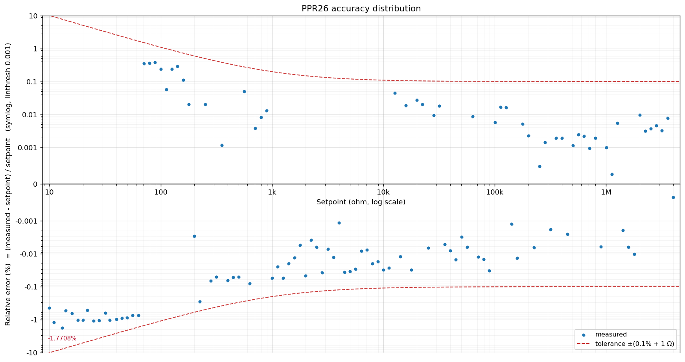

# 设备规格

PPR26 是一款精密程控电阻箱，采用继电器网络输出可编程电阻，支持 USB 控制与用户校准。

## 电阻输出

| 项目 | 说明 |
| ---- | ---- |
| 输出范围 | 5 Ω ~ 4 MΩ |
| 设定分辨率 | 1 mΩ（下发与读回的数值粒度） |
| 步进值 | 默认 1 Ω（1000 mΩ），可设置，掉电保存 |
| 输出方式 | 继电器网络输出（正常）、开路、短路 |
| 上电默认 | 开路 + 默认设定值 5 Ω |
| 补偿模式 | 不补偿 (UNCAL) / 附近最佳 (NEARBY) / 多档位最佳 (PRECISE)（默认多档位最佳） |
| 掉电保持 | 步进值、限值及使能、补偿模式、通信协议、数据集选择会保存；**设定阻值与输出状态不保存** |

!!! note "设定分辨率与实际可设定值不是一回事"
    **设定分辨率 1 mΩ** 指接口下发与读回阻值时的数值粒度；设备**实际能输出的阻值是一组离散值**，
    由 26 只电阻的继电器网络按子集和产生，并不是 1 mΩ 的均匀网格 —— 低阻端相邻可取值间隔约 1 Ω
    （最小增量 0.956 Ω，这也是步进值默认 1 Ω 的由来），高阻端间隔细得多。
    设定值若不在可取值上，设备会选取**最近的可取值**输出，实际输出可用 `AT+RES.PV?` 读回；
    全量程内设定值到最近可取值的偏差不超过约 ±0.5 Ω（低阻端最差），因此低阻端看到的较大相对误差
    是量化台阶而非故障，详见[精度测试脚本](../reference/scripts/accuracy.md)。

## 通信接口

| 项目 | 说明 |
| ---- | ---- |
| AT 模式 | USB CDC 虚拟串口，通常免驱，`115200 / 8 / None / 1` |
| SCPI 模式 | USB TMC，需安装驱动（推荐 NI‑VISA） |
| 固件升级 | USB（DFU 引导模式），可用后面板 DFU 按键或命令进入 |

通信模式切换见[通信模式切换](../quickstart/modeswitch.md)。

## 电气与结构

| 项目 | 说明 |
| ---- | ---- |
| 供电 | USB 供电，最大约 2.5 W（500 mA） |
| 输出端子 | 前面板 4 mm 香蕉头，2 × Sense + 2 × Output，不区分极性 |
| 数据接口 | 后面板 USB-B |
| 面板 | 后面板：电源指示灯、DFU 按键 |

## 温度测量

板载 NTC 温度传感器，可通过 AT / SCPI 查询当前、最高、最低与平均温度（分辨率 0.1 ℃）。

## 精度

每台设备出厂前都经过完整的精度测试，并随设备提供**出厂精度测试报告**（格式见下）。

| 项目 | 说明 |
| ---- | ---- |
| 出厂精度 | **±(0.1% × 设定值 + 1 Ω)** |
| 测试范围 | 10 Ω ~ 4 MΩ，对数均匀取点（每十倍 20 点，共 113 点），设定值取整到 1 Ω |
| 测量方式 | 四线法，6½ 位数字表（如 Agilent 34410A） |
| 合格判定 | 全部测试点落在容限内 |

容限是一条曲线：低阻端由绝对项（1 Ω）主导，高阻端由相对项（0.1%）主导 ——
10 Ω 处容限约 ±1.01 Ω（相对 ±10.1%），1 kΩ 处约 ±2 Ω（±0.2%），100 kΩ 处约 ±101 Ω（±0.101%）。

!!! warning "精度会随时间下降，需要定期重新校准"
    出厂精度是**出厂时**的指标。以下两项会让误差随时间增大：

    - **继电器触点串联电阻漂移**：低阻段误差主要来自这一项（每档输出都串有约 1~2 Ω 的链路
      串联电阻），实测同一设定值间隔数分钟复测，整条曲线即漂移数十 mΩ；
    - **标定标度漂移**：1 kΩ 以上还有正比于阻值的标度残差，随温度与老化变化。

    建议**每 12 个月重新校准一次**（对低阻精度要求高的场合可更频繁）。重新校准使用
    [校准脚本](../reference/scripts/calibration.md)配合一台足够准确的参考数字表即可完成，
    可修正触点串联电阻与标度残差；复检测量方法见[精度测试脚本](../reference/scripts/accuracy.md)。

### 出厂精度报告（格式示例）

报告随设备提供，内容如下。下表数据来自一台 PPR26 的出厂测试，**已隐去序列号等信息**。

**① 设备与测试信息**

| 字段 | 示例值 |
| ---- | ---- |
| 产品型号 | PPR26 |
| 序列号 | *（示例中隐去）* |
| 固件 / 硬件版本 | FW 1.0.0 / HW 5 |
| 制造日期 | *（示例中隐去）* |
| 测试日期 | 2026-10-14 |
| 参考表 | Agilent 34410A（*SN 隐去*），四线 |
| 设备温度 | 28.7 ℃ |

**② 测试设置**

| 项目 | 值 |
| ---- | ---- |
| 扫描范围 | 10 Ω ~ 4 MΩ，对数均匀、取整到 1 Ω |
| 测试点数 | 113（每十倍 20 点） |
| 每点设置 | 稳定 5 s，8 次读数平均，NPLC 10 |
| 判定标准 | ±(0.1% × 设定值 + 1 Ω) |

**③ 结果摘要**

| 区段 | 相对误差范围 | 绝对误差上界 | 结论 |
| ---- | ---- | ---- | ---- |
| 10 ~ 100 Ω | −1.77% ~ +0.38% | 0.47 Ω | 合格（低阻段为量化台阶） |
| 100 Ω ~ 1 kΩ | −0.29% ~ +0.29% | 0.64 Ω | 合格 |
| 1 k ~ 10 kΩ | −0.055% ~ −0.001% | 1.74 Ω | 合格 |
| 10 k ~ 100 kΩ | −0.032% ~ +0.046% | 28.8 Ω | 合格 |
| 100 kΩ ~ 4 MΩ | −0.014% ~ +0.017% | 277 Ω | 合格 |

**判定：合格** —— 113/113 点落在 ±(0.1% + 1 Ω) 内；最差点为 224 Ω
（−0.64 Ω = −0.29%，该点容限 ±1.22 Ω，用掉容限的 53%）。

**④ 精度分布图**

**⑤ 说明**

- 蓝色散点为数字表实测值，红色虚线为判定容限 ±(0.1% + 1 Ω)：散点全部落在容限内即为合格。
- 低阻段（10 ~ 100 Ω）的大相对误差来自 1 Ω 量化台阶，绝对误差仍在 1 Ω 容限内，
  判读方法见[精度测试脚本](../reference/scripts/accuracy.md)。
- 报告中的图表由测试 CSV 生成，可用[精度测试脚本](../reference/scripts/accuracy.md)自行复测复现。

!!! note "说明"
    完整规格以实际产品与随附测试报告为准。
